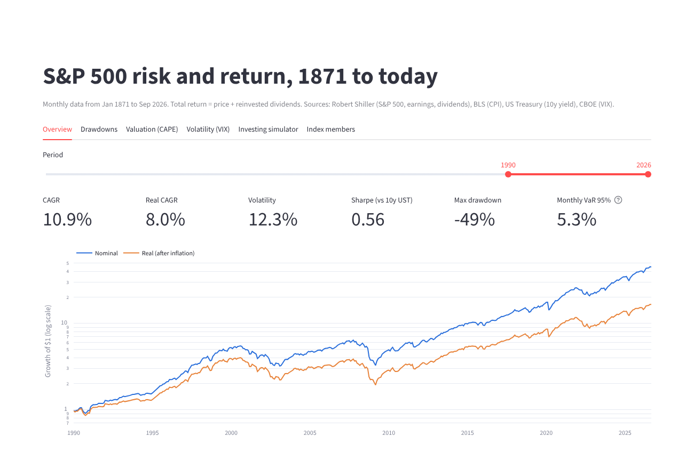
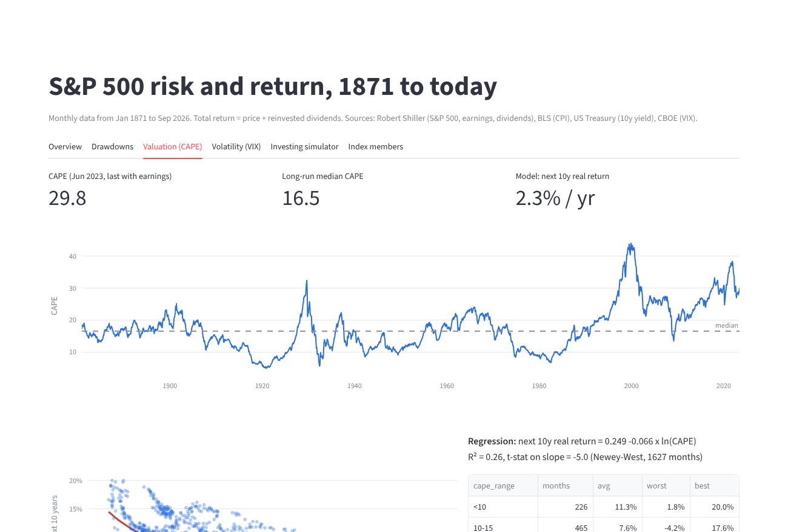
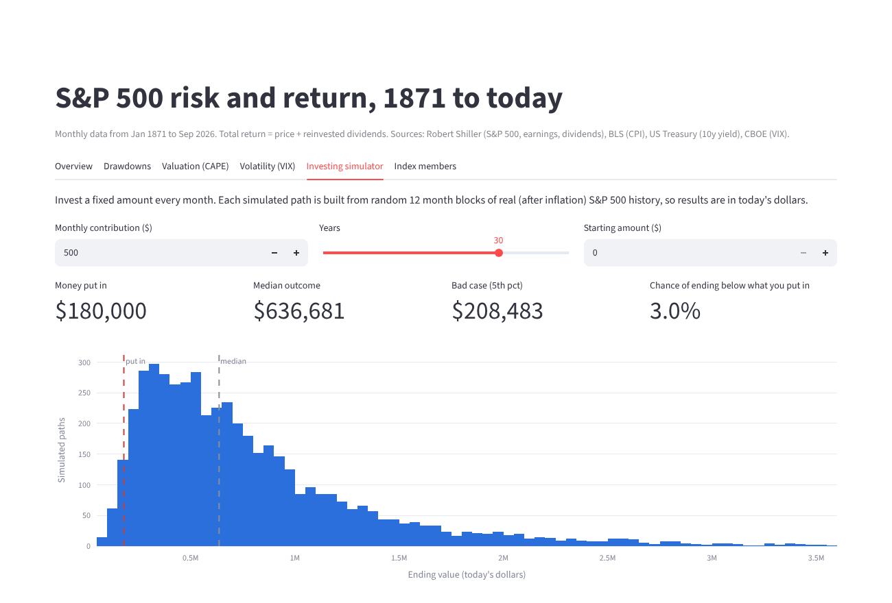

# S&P 500 risk analytics (1871 to 2026)


**Live app: [sp500-risk-analytics.streamlit.app](https://sp500-risk-analytics-zh2pj9a8osmogbshgql54s.streamlit.app/)**

I wanted to answer a few questions about the US stock market with real long-run data instead of opinions: how bad can it get, how long does it take to recover, does an expensive market really mean lower returns later, and what does investing every month actually look like over 30 years.

The data goes back to January 1871 (Robert Shiller's S&P 500 series), joined with BLS inflation, 10-year Treasury yields and the VIX. I modeled it in **dbt** on **DuckDB**, wrote the risk math as a small tested **Python** package, and put it all in a **Streamlit** app. **GitHub Actions** runs the dbt tests, unit tests, lint and a **Docker** build on every push.



## What I found

**Long run.** From 1871 to Sep 2026 the S&P 500 returned 9.4% a year with dividends reinvested, or 7.1% after inflation. Volatility was about 14% a year.

**Crashes.** There were 14 falls of 20% or more. The worst was 1929-1932 at -82%, and with dividends it took until January 1945 to get back to the 1929 peak. That's 15 years. 2000-2002 (-42%) and 2007-2009 (-49%) each took about 3.5 years to recover from the bottom.

**Lost decades are real.** The 2000s returned -0.7% a year (-3.2% after inflation). The 1910s and 1970s also lost money after inflation.

**Valuation matters, but only roughly.** I regressed the next 10 years' real return on log(CAPE):

- When CAPE was under 10, the next 10 years averaged 11.3% a year after inflation. When it was over 30, they averaged -1.0%.
- R² is 0.26 and the slope is clearly negative (t = -5.0 with Newey-West errors, since 10-year windows overlap).
- The last CAPE I can calculate is 29.8 (June 2023), which the model maps to about 2.3% a year real for the following decade. It's a wide estimate, not a forecast I'd bet on.



**High fear has been a decent time to buy.** In months when the VIX averaged over 30, the S&P was up over the next 12 months 91% of the time (average +25%). The weakest bucket was actually the "elevated" range of 20-30 (68% positive). Only 32 stress months since 1990, so small sample.

**Monthly investing.** Putting $500 a month into the index for 30 years ($180k total), using 5,000 simulations built from 12-month blocks of real history, the median outcome was about $637k in today's dollars. The 5th percentile was $208k, and about 3% of paths ended below the money put in.



**Index turnover.** 32% of today's S&P 500 companies were added in the last 10 years.

## So what? Decisions this supports

I wrote these for a team that builds a retirement or investing product (a robo-advisor, a 401(k) planner, a bank's savings app). They are about how to design and explain a product, not advice for any one person.

1. **Don't plan with the long-run average when the market is expensive.** The 7% real long-run return drops to about 2-3% in the model when CAPE is near 30. A planning tool that shows users one 7% line will over-promise. Better: show a range, and lower the default return assumption when valuations are high.
2. **Stress-test plans for long recoveries, not just big drops.** A -50% fall happened twice since 2000, and the worst recovery took 15 years. Anyone who needs the money within about 5 years shouldn't be 100% in stocks. A product can use this to set default stock/bond mixes by time horizon.
3. **Keep users invested during panics.** The months with the highest VIX were followed by the best 12-month returns in this sample. Panic selling locks in the loss. Practical ideas: a "markets are down, here's history" message instead of a big red number, or a short delay before a full sell-off order goes through.
4. **Show outcomes as a range, not a single number.** The simulator's 5th and 95th percentiles for the same $500/month plan are $208k and over $2M. Showing the median alone hides both the risk and the upside. Show the bad case next to the typical case.
5. **Report risk next to return.** A strategy with a great CAGR but a -50% drawdown is a different product. Max drawdown and time to recover should sit next to returns on any performance screen.

## How it's built

```
data/raw/*.csv
    │
    ▼
dbt (DuckDB)
    staging/        rename, fix types, turn "0 = not published" into nulls
    intermediate/   join S&P + CPI + Treasury, monthly returns, VIX by month
    marts/          fct_market_monthly, fct_drawdown_episodes, fct_decade_returns,
                    fct_vix_regimes, dim_constituents, fct_index_additions
    tests/          49 data tests (schema + custom)
    │
    ▼
src/riskkit/        CAGR, volatility, Sharpe, Sortino, drawdown, VaR/CVaR,
                    CAPE regression, Monte Carlo (13 pytest tests)
    │
    ▼
app/streamlit_app.py
```

Some SQL I'm happy with:

- **Drawdown episodes** (`fct_drawdown_episodes.sql`): gaps-and-islands. Each new all-time high starts a group, then I take the low point and the next high for every group.
- **Growth index** (`fct_market_monthly.sql`): `exp(sum(ln(1 + r)))` as a window function to compound returns.
- **My own CAPE** with a 120-month rolling window, and a test that it stays within 3% of Shiller's published number. The biggest difference is 1.1%.

## Data problems I had to deal with

- Shiller's file uses `0` for values that aren't published yet. From July 2023 there are no dividends or earnings, and from October 2023 no CPI or interest rate. Treating those as real zeros would wreck the return math, so staging turns them into nulls.
- I filled the missing CPI (34 months) from the BLS file and the missing yields from the Treasury file. A test checks that Shiller's CPI and BLS agree within 1% wherever both exist.
- For the 39 months without published dividends I carry the last known dividend forward and flag it (`is_dividend_estimated`), so total return for recent months is slightly approximate.
- Some "Founded" values in the members file look like `2013 (1888)`, so I keep the first year.

## Run it

```bash
pip install -r requirements-dev.txt
make all        # lint + dbt build (models and tests) + pytest
make app        # opens the Streamlit app
```

Or with Docker:

```bash
docker build -t sp500-risk-analytics .
docker run -p 8501:8501 sp500-risk-analytics
```

The app builds the database by itself the first time if `warehouse/market.duckdb` doesn't exist, so it also works on Streamlit Community Cloud (point it at `app/streamlit_app.py`).

`make docs` generates and serves the dbt docs with the lineage graph.

## Data sources

| File | Source |
|---|---|
| `sp500_monthly.csv` | Robert Shiller, S&P 500 monthly price, dividends, earnings, CPI, long rate, CAPE (1871-) |
| `cpi_monthly.csv` | BLS CPI-U, all items, not seasonally adjusted (1913-) |
| `treasury_10y_monthly.csv` | 10-year Treasury constant maturity yield (1953-) |
| `vix_daily.csv` | CBOE VIX daily (1990-) |
| `sp500_constituents.csv` | Current S&P 500 members with GICS sector and date added |

All files come from the [datasets](https://github.com/datasets) project on GitHub, which republishes these public series in clean csv form.

## Limitations

- Prices are monthly averages of daily closes (Shiller's method), so fast crashes look smaller than on daily data. COVID in 2020 and the 2022 bear market don't reach -20% here.
- Returns ignore fees, taxes and trading costs.
- Sharpe uses the 10-year Treasury yield as the risk-free rate because there's no long T-bill history in the data. A T-bill rate would give a slightly higher Sharpe.
- The CAPE result comes from overlapping windows and only about 13 non-overlapping decades, so it's directional.
- Survivorship: the members file only has today's companies, so the turnover numbers count additions of current members only.

Kuat Otarbayev
